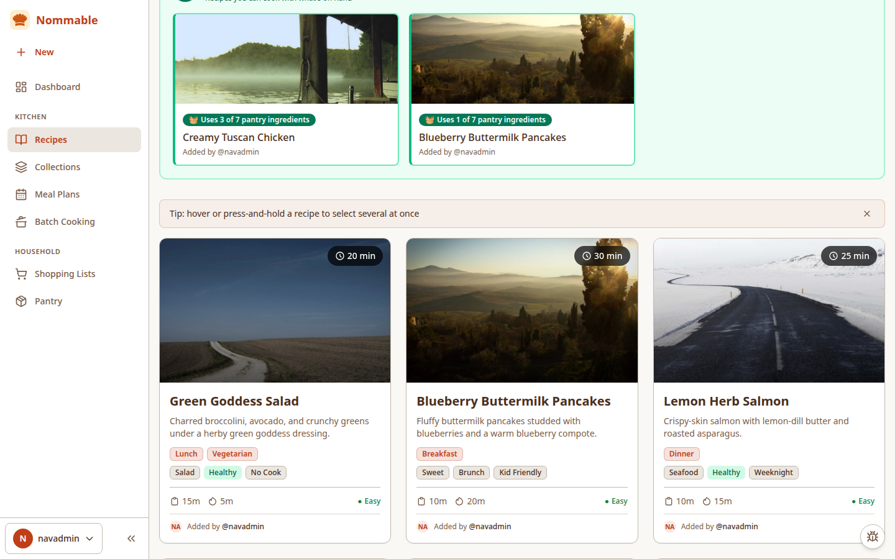
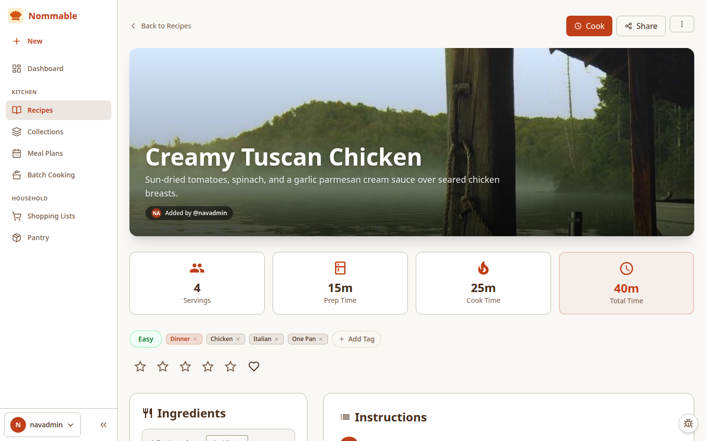
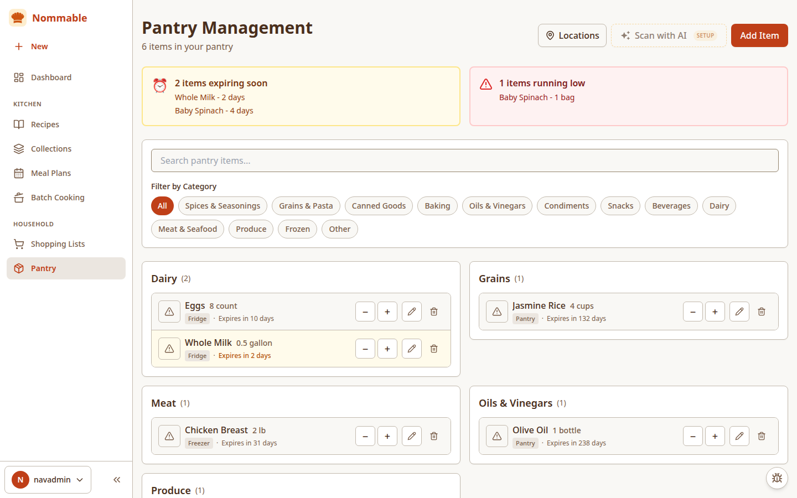
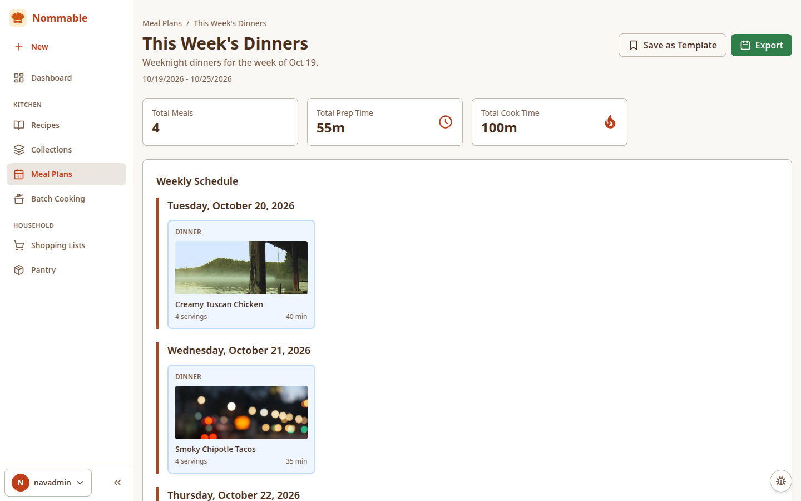
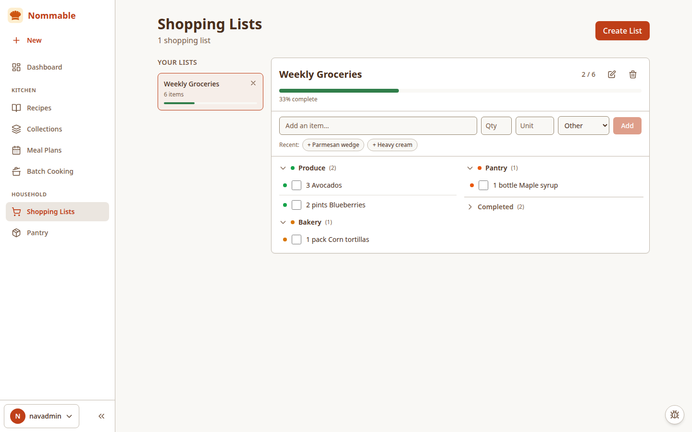

# Nommable

A self-hosted recipe management system with optional AI features powered by multiple providers (OpenAI, Anthropic, Google AI, Ollama).

## Screenshots

| Recipes                                                                                         | Recipe Detail                                                                                |
| ----------------------------------------------------------------------------------------------- | -------------------------------------------------------------------------------------------- |
|  |  |

| Pantry                                                                       | Meal Plans                                                                     | Shopping Lists                                                                 |
| ---------------------------------------------------------------------------- | ------------------------------------------------------------------------------ | ------------------------------------------------------------------------------ |
|  |  |  |

## Features

- **Recipe Management & Collections**: Create, import, and organize recipes into custom collections or Favorites using searchable multi-select dialogs (`Add Recipes` from collection pages or bulk `Add to Collection` from the Recipes page)
- **URL & Text Import**: Automatically extract recipes from cooking websites (with Cloudflare/WordPress REST API fallbacks) or by copy-pasting raw, unformatted recipe text from any source
- **AI-Powered Features** (Optional):
  - Generate recipes from ingredients or descriptions
  - AI Food Photography: Generate photorealistic culinary photos with Google Gemini 2.0 Flash / Imagen 3 or OpenAI GPT-Image models (`gpt-image-1.5`, `gpt-image-2.5-sunburst`, `gpt-image-1`) with independent image model selection and transparent fallback for legacy DALL-E configs
  - Smart meal planning suggestions
  - Ingredient substitution recommendations
  - Recipe enhancement
- **Pantry Inventory & Smart Suggestions**: Track pantry stock, expiration status, and low-stock alerts in a compact row layout, with a dedicated **"Suggested from your pantry"** band on the Recipes page displaying per-recipe `"Uses N of M pantry ingredients"` match badges
- **Meal Planning**: Plan multiple recipes per day across Breakfast, Lunch, Dinner, and Snack slots with optional meal times (`[HH:MM]`) and reusable meal-plan templates
- **Shopping Lists**: Auto-generate shopping lists from meal plans or add items via a pinned quick-add bar with one-tap recent item chips, automatic keyword-based grocery category detection (~180 common items), collapsible aisle sections, and a collapsed Completed section
- **Batch Cooking**: Guided 3-step batch cooking session wizard (select recipes → review portions & local-calendar prep date → generate timeline), one-click `Freezer-Friendly` tag bootstrapping, and batch cooking analytics
- **Multi-Provider AI & BYOK (Bring Your Own Key)**: Choose your preferred AI provider (OpenAI, Anthropic, Google AI, Ollama, or none) with dynamic model listing, 1-hour caching, live model refresh, independent text vs image models, custom model overrides, and admin-selectable **Shared Instance Key** vs. **Per-User BYOK** modes
- **Granular Shared Library, Creator Attribution & Per-User Taxonomies**: Choose which elements are shared across all household/team users in Admin Settings — **Recipes & Tags** (with optional **"Show who added or created each recipe"** attribution badges), **Collections & Favorites**, **Meal Plans & Templates**, **Shopping Lists**, **Pantry Inventory**, and **Batch Cooking Plans** — or switch to **Per-User Private Library** mode at any time, with per-user category/tag taxonomy scoping
- **In-App Feedback Widget & Admin Inbox**: Built-in floating feedback widget for reporting bugs or requesting features (automatically capturing route, viewport, and browser metadata) paired with an admin-only `/admin/feedback` triage inbox
- **System Status & Updates**: Admin-only **Settings → System** tab shows installed vs. available version, release notes, uptime, database and uploads size, last backup/restore, and migration status — updates are applied manually via your deployment (see [Updating](https://github.com/mortegaux/nommable/wiki/Updating))
- **Backup & Restore**: Full backup export (database + uploads + versioned manifest) with validated, previewed restore — see [Backup & Restore](https://github.com/mortegaux/nommable/wiki/Backup-and-Restore)
- **Kitchen Today**: A `/kitchen-today` home screen with your next action, expiring items, tonight's plan, prep due, leftovers, and low stock

## User Guide

Step-by-step instructions for using Nommable live in the [wiki](https://github.com/mortegaux/nommable/wiki):

- [Getting Started](https://github.com/mortegaux/nommable/wiki/Getting-Started) — install, first-run setup, creating your admin account
- [Updating](https://github.com/mortegaux/nommable/wiki/Updating) — checking for updates and applying them
- [Filing Bugs & Requesting Features](https://github.com/mortegaux/nommable/wiki/Filing-Bugs-and-Requesting-Features) — using the in-app feedback widget
- [Importing Recipes](https://github.com/mortegaux/nommable/wiki/Importing-Recipes) — URL import and pasted-text import
- [AI Setup](https://github.com/mortegaux/nommable/wiki/AI-Setup) — adding AI provider keys (shared key vs. per-user BYOK), models, image generation
- [Recipes](https://github.com/mortegaux/nommable/wiki/Recipes) — creating, organizing, generating, and photographing recipes
- [Pantry](https://github.com/mortegaux/nommable/wiki/Pantry) — tracking stock, expiry, low stock, and AI pantry scan
- [Meal Planning](https://github.com/mortegaux/nommable/wiki/Meal-Planning) — plans, templates, and Kitchen Today
- [Shopping Lists](https://github.com/mortegaux/nommable/wiki/Shopping-Lists) — generating lists from plans, quick-add, categories
- [Batch Cooking](https://github.com/mortegaux/nommable/wiki/Batch-Cooking) — the batch session wizard and freezer-friendly tags
- [Backup & Restore](https://github.com/mortegaux/nommable/wiki/Backup-and-Restore) — exporting backups and restoring them
- [Users & Sharing](https://github.com/mortegaux/nommable/wiki/Users-and-Sharing) — invitations, roles, shared vs. private library
- [Email Setup](https://github.com/mortegaux/nommable/wiki/Email-Setup) — SMTP configuration for invitations
- [Home Assistant](https://github.com/mortegaux/nommable/wiki/Home-Assistant) — read-only summary endpoints for automation

## Tech Stack

**Backend:**

- Node.js + TypeScript
- Express.js
- TypeORM + SQLite (better-sqlite3)
- Better Auth (vetted auth library — sessions, password hashing, admin)
- Multiple AI SDK integrations

**Frontend:**

- React 18 + TypeScript
- Vite
- React Router
- Zustand (State Management)
- Tailwind CSS

**DevOps:**

- Docker + Docker Compose (single container)
- npm workspaces (monorepo)

## Quick Start

### Prerequisites

- Node.js 20+ and npm 9+
- Docker and Docker Compose (for containerized deployment)

### Development Setup

1. **Clone the repository:**

   ```bash
   git clone https://github.com/mortegaux/nommable.git
   cd nommable
   ```

2. **Install dependencies:**

   ```bash
   npm install
   ```

3. **Set up environment variables:**

   ```bash
   cp packages/backend/.env.example packages/backend/.env
   # Edit packages/backend/.env with your configuration
   ```

4. **Start the backend** (SQLite DB is created automatically on first run):

   ```bash
   npm run dev:backend
   ```

5. **Start the frontend** (in a new terminal):

   ```bash
   npm run dev:frontend
   ```

6. **Access the application:**
   - Frontend: http://localhost:5173
   - Backend API: http://localhost:3001

### Docker Deployment (single container)

```bash
cp .env.example .env
# Edit .env — set BETTER_AUTH_SECRET, ENCRYPTION_KEY
docker compose up -d
```

One container, one volume (`/data` holds the SQLite database + uploads), one port.

- App: http://localhost:8992 (API at `/api`, first-run onboarding wizard at `/setup`)

Secrets are never committed — `docker-compose.yml` reads them from a gitignored `.env` file
(or from Portainer stack environment variables).

### One-Click Cloud Deployment

Deploy a single-container instance with persistent `/data` storage on Railway or Render:

- **Railway**: Uses [`railway.json`](./railway.json) — attach a volume mounted at `/data` and set `BETTER_AUTH_SECRET` and `ENCRYPTION_KEY`.
- **Render**: Uses [`render.yaml`](./render.yaml) — automatically provisions a 5 GB persistent disk at `/data` and generates `BETTER_AUTH_SECRET` and `ENCRYPTION_KEY`.

## AI Configuration

After creating an account, navigate to **AI Settings** to configure your preferred AI provider:

1. Choose your provider (OpenAI, Anthropic, Google AI, or Ollama)
2. Enter your API key (not required for Ollama)
3. Select your Text & Recipe Generation model from the dynamically populated list (or click **"Refresh models"** to query the provider live for newly released or installed models; custom model names are also supported)
4. (Optional) Configure an independent **Image Generation Model** (OpenAI `gpt-image-1.5`, `gpt-image-2.5-sunburst`, `gpt-image-1`, Google Gemini 2.0 Flash, or Imagen 3) with an optional dedicated image API key for cross-provider generation
5. Enable AI features

**Note:** AI features are completely optional. The app works fully without any AI configuration.

## Project Structure

```
nommable/
├── packages/
│   ├── backend/          # Express API server
│   │   ├── src/
│   │   │   ├── api/      # Routes, controllers, middleware
│   │   │   ├── services/ # Business logic (AI, recipes, etc.)
│   │   │   ├── db/       # Database entities and migrations
│   │   │   └── config/   # Configuration
│   │   └── package.json
│   ├── frontend/         # React web app
│   │   ├── src/
│   │   │   ├── features/ # Feature modules
│   │   │   ├── services/ # API client
│   │   │   └── store/    # State management
│   │   └── package.json
│   └── shared/           # Shared TypeScript types
│       └── src/types/
├── docker-compose.yml
└── package.json          # Root workspace config
```

## Development

### Running Tests

```bash
# Run backend tests
npm run test -w packages/backend

# Run frontend tests
npm run test -w packages/frontend
```

### Database Migrations

```bash
# Generate a new migration
npm run migration:generate -w packages/backend -- -n MigrationName

# Run migrations
npm run migration:run -w packages/backend

# Revert last migration
npm run migration:revert -w packages/backend
```

### Code Quality

```bash
# Lint all packages
npm run lint

# Format code
npm run format
```

## API Documentation

The backend API is available at `http://localhost:3001/api` with the following endpoints:

- **Auth**: `/api/auth` - User registration and login
- **Recipes**: `/api/recipes` - CRUD operations, import, AI generation, and AI culinary photo generation (`/api/recipes/:id/generate-image`, `/api/recipes/generate-image`)
- **Users**: `/api/users` - User management, role assignment, password reset, and admin safeguards
- **Invitations**: `/api/invitations` - Invitation tokens, validation, resending, and revocation
- **Settings**: `/api/settings` - System catalog sharing & author attribution (`/api/settings/general`), SMTP configuration & test delivery (`/api/settings/smtp`, `/api/settings/smtp/test`), and database management (`/api/settings/data/clear`)
- **AI**: `/api/ai` - AI configuration, dynamic model listing (`/api/ai/models`), test connection, and ingredient substitution
- **Meal Plans**: `/api/meal-plans` - Meal planning and management
- **Shopping Lists**: `/api/shopping-lists` - Shopping list management
- **Home Assistant**: `/api/home-assistant` - Read-only JSON summaries for automation (tonight's dinner, low stock, expiring items, active shopping lists). See [Home Assistant](#home-assistant) below.

### Home Assistant

Four read-only endpoints for automation consumers. They use the existing session auth (no separate API tokens yet — those are a planned follow-up in #34). Two ways to authenticate:

- **Browser / same-origin requests:** sign in via the web UI. Login sets the signed `nommable.session_token` cookie, and same-origin requests (including direct navigation to the endpoint URLs) authenticate with it.
- **Home Assistant / API clients:** send `Authorization: Bearer <session token>`, where the session token is the `token` from the `POST /api/auth/login` JSON response. Alternatively, send the signed cookie itself as a `Cookie: nommable.session_token=<value>` header (copy the value from browser devtools after signing in) — but note the cookie value is HMAC-signed and is **not** a Bearer token; sending it as `Authorization: Bearer` will fail.

```yaml
# configuration.yaml — one REST sensor per summary
# Bearer token = `token` from the POST /api/auth/login JSON response
rest:
  - resource: http://localhost:8992/api/home-assistant/tonights-dinner
    headers:
      Authorization: 'Bearer <session token from login response>'
      Authorization: 'Bearer <session token from login response>'
    sensor:
      - name: "Tonight's Dinner"
        value_template: "{{ value_json.meals[0].recipeTitle if value_json.count > 0 else 'Nothing planned' }}"
        json_attributes:
          - meals
          - count
  - resource: http://localhost:8992/api/home-assistant/low-stock
    headers:
      Authorization: 'Bearer <session token from login response>'
    sensor:
      - name: 'Low Stock Items'
        value_template: '{{ value_json.count }}'
        json_attributes:
          - items
  - resource: http://localhost:8992/api/home-assistant/expiring
    headers:
      Authorization: 'Bearer <session token from login response>'
    sensor:
      - name: 'Expiring Items'
        value_template: '{{ value_json.count }}'
        json_attributes:
          - items
  - resource: http://localhost:8992/api/home-assistant/shopping-lists
    headers:
      Authorization: 'Bearer <session token from login response>'
    sensor:
      - name: 'Active Shopping Lists'
        value_template: '{{ value_json.totalUnchecked }}'
        json_attributes:
          - lists
```

Endpoints (`GET`, all require auth):

- `/api/home-assistant/tonights-dinner` — today's dinner if one is planned, otherwise all of today's meals: `{ date, meals: [{ planId, planName, mealId, mealType, recipeId, recipeTitle, time, notes }], count }`
- `/api/home-assistant/low-stock` — `{ items: [{ id, name, quantity, unit, category, location }], count }`
- `/api/home-assistant/expiring?days=7` — items expiring within the window (default 7, clamped 1–30), soonest first: `{ windowDays, items: [{ id, name, quantity, unit, category, location, expirationDate, daysUntilExpiry }], count }`
- `/api/home-assistant/shopping-lists` — lists with unchecked items: `{ lists: [{ id, name, uncheckedCount, totalCount, items: [{ name, quantity, unit, category }] }], count, totalUnchecked }`

Derivation matches the Kitchen Today screen (same 7-day expiry window, same dinner-preferred rule, same local-calendar-day math). Session tokens expire — if a sensor starts returning 401, sign in again and refresh the token.

## Environment Variables

See `packages/backend/.env.example` for all available configuration options.

Key variables:

- `BETTER_AUTH_SECRET`: Secret for Better Auth session signing (min 32 chars; `JWT_SECRET` accepted as legacy alias)
- `ENCRYPTION_KEY`: 32-byte hex key for AES-256-GCM encryption of stored AI API keys and SMTP credentials at rest
- `DB_PATH`: SQLite database file path (default: `/data/nommable.db` in Docker, `./nommable.db` locally)
- `ADMIN_USERNAME` / `ADMIN_PASSWORD`: Initial admin account (created on first run)
- `SMTP_*`: Optional fallback SMTP host, port, user, pass, and from address for sending invitation emails (can also be configured directly in Admin Settings → Email / SMTP)
- `OPENAI_API_KEY`: OpenAI API key (optional)
- `ANTHROPIC_API_KEY`: Anthropic API key (optional)
- `GOOGLE_AI_API_KEY`: Google AI API key (optional)
- `OLLAMA_BASE_URL`: Ollama server URL (optional)

## Data Persistence

All persistent data lives on the `/data` volume:

- `/data/nommable.db` — SQLite database (WAL mode)
- `/data/uploads` — uploaded images and files

Back up the volume to back up everything.

## Backup & Restore

Admins can export a full backup from **Settings → Data Management → Backup & Restore**.
The download is a single `.zip` containing:

- `manifest.json` — format version, app version, created-at time, entity counts, schema version
- `database.db` — a consistent snapshot taken with better-sqlite3's `.backup()` (never a raw copy of the live file)
- `uploads/` — the full uploads tree

Restore is a two-step flow: upload the archive to get a **preview** (entity counts from the backup, validated before anything is touched), then confirm with the checkbox. On confirm the server writes a safety backup of the current data to `/data/backups/safety-<timestamp>.zip`, swaps in the restored database + uploads, and restarts. The System tab shows the last backup and last restore times.

Backups are validated before applying: manifest version/shape, schema compatibility (a backup from a newer app version is rejected), manifest counts vs. the backup database, and zip-slip defenses (only `manifest.json`, `database.db`, and `uploads/*` entries are allowed). Restore uploads are capped at 1 GiB and are admin-only.

## Security

Nommable is built for self-hosting with defense-in-depth:

- **Authentication**: Better Auth (vetted library, MIT) — scrypt password hashing, stateful sessions, admin plugin; no hand-rolled crypto. The SPA authenticates with `Authorization: Bearer` session tokens.
- **Flexible recipe sharing & per-user ownership**: Personal data (meal plans, shopping lists, pantry items, analytics, batch cooks, and meal-plan templates) is strictly scoped to the authenticated `userId`, while recipes support either a shared household catalog (with optional creator attribution) or strict per-user private isolation.
- **Admin-gated operations**: System settings, SMTP configuration, user management, and destructive actions require an admin role.
- **Input validation**: All request bodies and query params are validated and coerced with Zod.
- **Encrypted secrets**: AI provider API keys and SMTP passwords are encrypted at rest (AES-256-GCM) via the `ENCRYPTION_KEY` env var.
- **Secret hygiene**: `docker-compose.yml` contains no hardcoded secrets (all via gitignored `.env`); the backend refuses to boot in production with a missing `ENCRYPTION_KEY` or default `BETTER_AUTH_SECRET` / `ADMIN_PASSWORD` values.
- **Rate limiting**: Tiered limits (global, auth, and AI endpoints).
- **Safe defaults**: TypeORM `synchronize` is disabled (migrations only), CORS defaults are locked to known origins, and recipe imports use `execFile` (no shell interpolation).
- **Uploads**: File extensions are derived from validated MIME types rather than user-supplied filenames.

Set a strong `BETTER_AUTH_SECRET` and `ENCRYPTION_KEY`, and a restrictive `CORS_ORIGIN`, before deploying to production.

## Contributing

Contributions are welcome! Please feel free to submit a Pull Request.

## License

MIT License - see LICENSE file for details

## Support

For step-by-step instructions, see the [User Guide wiki](https://github.com/mortegaux/nommable/wiki). To report a bug or request a feature, use the in-app feedback widget (floating button, bottom-right) or [open an issue on GitHub](https://github.com/mortegaux/nommable/issues) — see [Filing Bugs & Requesting Features](https://github.com/mortegaux/nommable/wiki/Filing-Bugs-and-Requesting-Features) for what to include.
